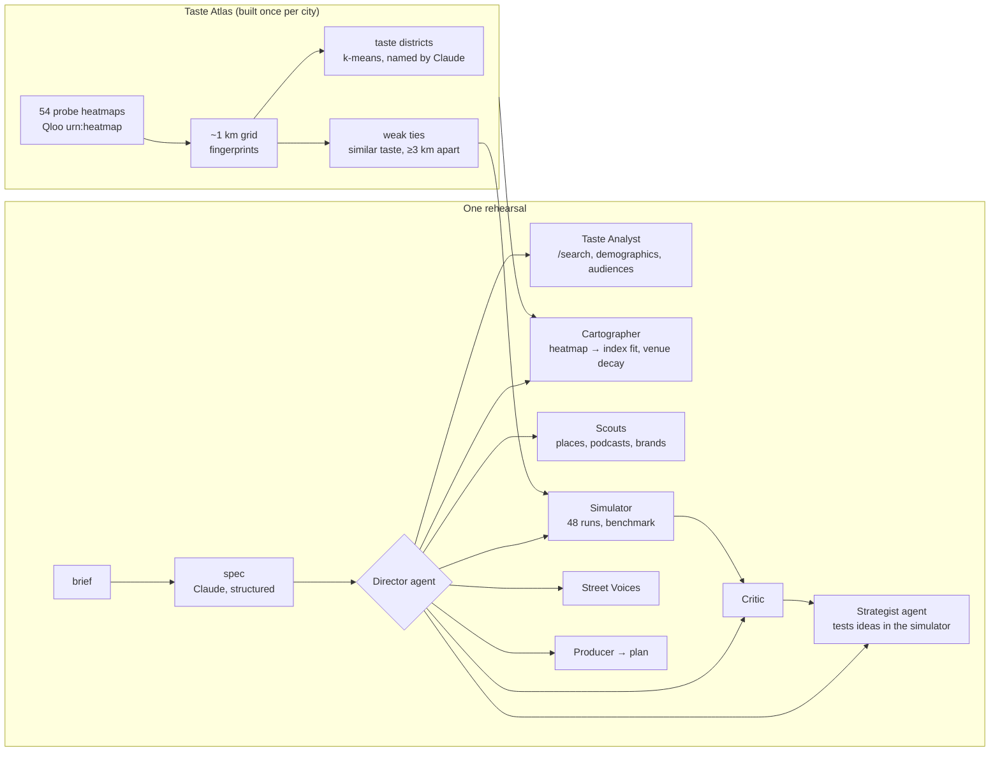

<p align="center">
  
</p>

<h1 align="center">Groundswell</h1>

<p align="center"><strong>A flight simulator for culture.</strong><br />
Groundswell builds a street-level model of a real city from Qloo's taste graph. A team of nine AI agents rehearses your launch inside it hundreds of times, then hands you the plan that worked, with real places, podcasts and partners.</p>

<p align="center">
  <a href="#run-it-locally"><b>Run it locally</b></a> ·
  <a href="#evidence">Evidence</a> ·
  <a href="#how-it-works">How it works</a> ·
  <a href="#use-it-from-an-agent-mcp">MCP</a>
</p>

---

## For judges: the short version

| Criterion | Where to look |
|---|---|
| **Qloo, used unusually** | Qloo heatmaps of 54 probe entities become a taste model of 7 cities at ~1 km resolution (10,636 cells), with taste districts and cross-city twins. Every launch is mapped, scouted and simulated from Qloo data: heatmaps, places with explainability, podcasts, brands, demographics, audiences, tags. [Details](#qloo-end-to-end) |
| **Agentic** | A Director agent whose tools are eight teammates; a Strategist agent that tests ideas in a simulator before committing; a Critic that sends plans back; guardrails enforced in the tools. Two or more rounds of plan → simulate → critique on every run. [Details](#the-agents) |
| **Evidence** | From comparables alone, Groundswell finds **45%** of the neighbourhoods where a held-out taste is over-represented, against **24%** for Claude alone, **22%** for "where people are" and **10%** for chance (77 tests, 7 cities, 95% interval 40–50%). [Details](#evidence) |
| **Impact** | Every launch (a show, a comedy night, a store, a pop-up, a film) is a bet on where to light the match. Big companies run research; everyone else guesses. Seven recorded rehearsals beat a same-budget plan without taste data by roughly 3–4×. |
| **Working product** | The live app runs a full rehearsal in about three minutes and streams every step; seven recorded rehearsals open instantly. Taste Atlas, method page, MCP server, tests and CI. |

## What it does

1. **You describe a launch.** "A Latin R&B singer in the vein of Omar Apollo plays their first headline show at Thalia Hall in Pilsen in six weeks. $12,000." Pick a city.
2. **The team rehearses it.**
   - The **Taste Analyst** finds the comparables on Qloo and who their fans are.
   - The **Cartographer** maps where in the city that taste lives, corrected for data density, and finds the venue so distance counts.
   - **Scouts** find real partner places in each hot zone (with addresses and the comparable that pulled each in), plus podcasts and brands the audience over-indexes on.
   - The **Strategist** designs three different bets and tests variations in the simulator.
   - The **Simulator** rehearses each plan 48 times through a model of word of mouth, against a benchmark that spends the same budget where people are.
   - The **Critic** reads the results and sends changes back; the Strategist revises; the Simulator runs again.
   - **Street Voices** (simulated residents of the hot zones, labelled as such) react to the plan.
   - The **Producer** writes the week-by-week launch plan.
3. **You get the plan that worked**: partners with addresses, media, a schedule, simulated reach with a bad-case band, the benchmark it beat, risks and what to measure. Exports as CSV and JSON.

The whole time, the city on screen changes: districts, then where the taste lives, then partner pins, then word of mouth spreading day by day.

## Recorded rehearsals

Real runs of the full team, recorded with every event so they replay exactly:

<!-- SHOWCASES -->
| Launch | City | Plan's reach | Same budget, no taste data | Rounds | Qloo requests |
|---|---|---|---|---|---|
| **A first headline show**: 1,200 tickets at Thalia Hall in Pilsen, six weeks out. | Chicago | **20.8%** (3.3×) | 6.3% | 2 | 19 |
| **A clean comedy night**: A family-friendly stand-up night at the Tabernacle. | Atlanta | **11.1%** (2.6×) | 4.2% | 2 | 19 |
| **A football fan zone**: Chelsea F.C. match nights and a kit drop, eight weeks out. | London | **26.0%** (3.2×) | 8.1% | 2 | 18 |
| **A Dodgers pop-up in Tokyo**: An Ohtani-season pop-up store and viewing party. | Tokyo | **20.2%** (3.3×) | 6.1% | 2 | 18 |
| **Indie film previews**: An A24 coming-of-age film's preview week in Williamsburg. | New York | **17.6%** (4.2×) | 4.2% | 2 | 19 |
| **A startup's first store**: A sustainable sneaker brand's pop-up in Roma Norte. | Mexico City | **23.6%** (3.5×) | 6.7% | 2 | 17 |
| **An album release party**: A rap album release show at the Wiltern in Koreatown. | Los Angeles | **17.6%** (4.4×) | 4.0% | 2 | 19 |

Reach is the share of the city's natural audience (people whose taste fits the launch, weighted by distance to the venue) reached by launch day in the simulation.
<!-- /SHOWCASES -->

## Evidence

**Can comparables find a new launch's audience?** Everything rests on this: a launch has no data of its own, so Groundswell locates its audience from comparables. For 12 established artists, brands and shows that are not atlas probes, in each of 7 cities, we predict where each one's audience is from three Qloo-similar comparables alone, never looking at its own heatmap. The truth is its own Qloo heatmap; we count how many of its top 10% of cells each method finds.

| Method | Over-representation (index) | Raw volume |
|---|---|---|
| **Groundswell** (comparables, density-corrected index) | **44.8%** (40.0–49.8) | 21.4% |
| The same comparables, raw heatmap | 28.0% | 76.2% |
| Claude alone, naming neighbourhoods with coordinates | 23.7% | 62.5% |
| Where people are (activity, no taste) | 22.0% | 82.5% |
| Control: the density correction alone | 0.5% | 0.0% |
| Chance | 10.0% | 10.0% |

- Groundswell is ahead in every city (36–56%) and beats Claude alone in 65 of 77 tests. 7 tests were skipped where Qloo's heatmap covered under 15% of the city.
- The control finds 0.5%, so the result is not an artefact of measuring truth and prediction the same way; the comparables carry it.
- On raw volume, "where people are" wins: Qloo's raw heatmaps are densest wherever people are, for every taste. That is why the simulator multiplies population (volume) by the index (where the taste is).
- Reproduce: `npm run benchmark`. Results: [`data/benchmark/coldstart.json`](data/benchmark/coldstart.json).

**Calibration.** Word-of-mouth parameters were chosen by sweeping them over three real launches and keeping a regime where an unpromoted launch stays near 2–3%, results are not knife-edge, and no single channel always wins (`npm run calibrate`, results in [`data/benchmark/calibration.json`](data/benchmark/calibration.json)). The right strategy depends on the geography of the taste: where an audience is concentrated, seeding its neighbourhoods compounds; where it is spread across a sprawling city, media leads.

**Tests.** Unit tests for the simulator, the atlas build, the benchmark metrics, fit, zones, partner filters and action costs (`npm test`). CI runs lint, typecheck, tests and a production build.

## How it works



### The city model

For each city, Qloo's heatmap (`filter.type=urn:heatmap`, a point and radius) is pulled for 54 probes: artists, series, brands, games, podcasts, athletes. Cells present for at least eight probes form the grid. Each cell's fingerprint is its within-city percentile for every probe, corrected for how many probes Qloo returns there (busy downtown cells appear for everything), clipped, coverage-weighted and centred. Cells cluster into 5–7 taste districts, named by Claude from the signature only. Each cell is tied to its four most taste-similar cells at least 3 km away: weak ties that carry word of mouth across town. Taste twins compare districts across cities.

### Where a launch lands

A cell's fit is its percentile for the comparables minus its baseline (what it shows for everything), re-ranked: an index of where the taste is over-represented. Population is a floor plus damped Qloo activity. With a venue, people are weighted by `exp(−distance / 7 km)` (Huff's distance decay). Natural audience = population × 0.25 × fit³ × travel.

### The simulation

[`packages/sim`](packages/sim) is a standalone package: a stochastic, spatial Bass diffusion with complex contagion.

```
h = baseRate + Σ promotion reaching the cell today + wom × exposure^k
```

Exposure is the share of the cell's social neighbourhood (itself, adjacent cells, weak ties) currently talking about the launch; talk fades with a 6-day half-life; k = 1.5 makes clustered buzz spread where thin awareness fizzles (Centola & Macy 2007). Counts are binomial draws; each plan runs 48 times for a mean and a 10th–90th percentile band. Every adopter is credited to an action, word of mouth or organic discovery. A greedy optimiser and an expected-value mode support the agents.

Action effects and costs are stated assumptions in one file ([`src/lib/launch/actions.ts`](src/lib/launch/actions.ts)) and on the method page.

### The agents

All on Claude (`claude-opus-5-5`) through the Anthropic SDK (tool runner, structured outputs, server-side refusal fallbacks).

- **Director**: an agent whose tools are `profile_taste`, `map_audience`, `scout`, `plan`, `simulate`, `critique`, `interview` and `finalize`. It decides the order, retries failures (for example replacing comparables Qloo can't resolve), picks which zones to scout, and decides when to stop. Each call carries a one-sentence reason shown to the viewer.
- **Strategist**: an agent with `estimate` (instant expected-value simulation) and `submit_plans`. It tests variations before committing.
- **Critic, Street Voices, Producer**: structured-output calls grounded in the run's data.

Guardrails live in the tools: plans use only scouted menu items, stay within budget, can't stack more collabs, podcasts or pop-ups than a real team would run, and `finalize` refuses before two rounds of plan → simulate → critique. Partners never include schools, places of worship, clinics, government buildings, gun or cannabis shops, or the launch's own venue; all-ages briefs drop bars. Agents report reach and cost per point of reach, never head-counts (the simulation's population scale is arbitrary).

### Qloo, end to end

| Qloo request | Used for |
|---|---|
| `/v2/insights` `filter.type=urn:heatmap`, `filter.location` (WKT point + radius) | The atlas (54 probes × 7 cities), each launch's fit, brand-collab reach, the benchmark |
| `/v2/insights` `urn:heatmap` + `output.heatmap.boundary=urn:entity:locality` | Neighbourhood names and boundaries |
| `/v2/insights` `urn:entity:place`, `filter.location`, `feature.explainability` | Partner places in each hot zone and which comparable pulled each in |
| `/v2/insights` `urn:entity:podcast`, `urn:entity:brand` (+ `signal.location.query`) | Podcasts and local brands the audience over-indexes on |
| `/v2/insights` `urn:demographics`, `urn:audience`, `urn:tag` | Who the comparables' fans are |
| `/search` (+ `filter.location` for venues) | Resolving comparables, venues and probes, with a name check |

The Qloo client ([`src/lib/qloo/client.ts`](src/lib/qloo/client.ts)) whitelists parameters (Qloo silently ignores unknown ones), paces requests under the key's rate limit, retries with `Retry-After`, shares identical in-flight requests and caches responses. A live rehearsal makes about 20 Qloo requests.

## Tech stack

| Layer | Choice |
|---|---|
| App | Next.js 15.5 (App Router), React 19.1, TypeScript, Tailwind CSS 4 |
| Map | deck.gl 9.4 on MapLibre GL 6 with OpenFreeMap tiles |
| Simulation | `@groundswell/sim` (this repo, no dependencies) |
| Agents | Anthropic Claude `claude-opus-5-5`, `@anthropic-ai/sdk` tool runner and structured outputs |
| Taste data | Qloo Taste AI API (hackathon host) |
| Agents' protocol | Model Context Protocol server, `@modelcontextprotocol/sdk` |
| Tests and CI | Vitest, GitHub Actions |

## Project structure

```text
groundswell/
├── packages/sim/              # the simulation engine (spatial Bass diffusion, Monte Carlo, optimiser)
├── src/
│   ├── app/                   # pages: home, rehearse/[id], rehearse/live, atlas, method; api routes
│   ├── components/            # city map, war room, plan sheet, atlas explorer, home
│   └── lib/
│       ├── qloo/              # Qloo client, parameter whitelist, typed operations
│       ├── atlas/             # cities, probes, atlas build, districts, twins
│       ├── launch/            # spec, taste, fit, scouting, actions, simulation wrapper, venue
│       ├── agents/            # Director, Strategist, Critic, Voices, Producer, run orchestration
│       └── bench/             # cold-start benchmark metrics
├── scripts/                   # build-atlas, record-showcases, benchmark, calibrate, launch
└── data/                      # built atlases, recorded rehearsals, benchmark results
```

## HTTP API

| Route | Purpose |
|---|---|
| `POST /api/rehearse` (server-sent events) | A live rehearsal: `{brief, cityId, budget?, days?}` |
| `GET /api/showcase/:id` | A recorded rehearsal |
| `GET /api/atlas/:city` | A city's atlas |
| `GET /api/twins` | Taste twins between districts across cities |
| `/api/mcp` | MCP server |

Live rehearsals are rate-limited per IP (4 per half hour) to protect the shared quotas.

## Use it from an agent (MCP)

Streamable HTTP at `<origin>/api/mcp`. For example, in Claude Code: `claude mcp add --transport http groundswell <origin>/api/mcp`.

Tools: `list_cities`, `taste_twins`, `map_launch_audience`, `scout_launch_partners`, `rehearse_launch`, `get_recorded_rehearsal`. Try `npm run mcp:smoke` against a running server.

## Run it locally

You need Node.js 22.9 or newer, a Qloo hackathon API key and an Anthropic API key.

```bash
git clone <this repository>
cd groundswell
npm install                     # also copies MapLibre's worker into public/
cp .env.example .env            # add QLOO_API_KEY and ANTHROPIC_API_KEY
npm run dev                     # http://localhost:3000
```

The built atlases, recorded rehearsals and benchmark results are in `data/`, so the app works straight away. To rebuild from Qloo with your own key:

| Command | What it does | Cost |
|---|---|---|
| `npm run atlas` | Rebuild all city atlases (or `npm run atlas -- chicago`) | ~55 Qloo requests per city, 1 Claude call per city |
| `npm run record` | Record the showcase rehearsals (or `npm run record -- chicago-headline`) | ~20 Qloo and ~25 Claude calls each |
| `npm run benchmark` | The cold-start test | ~350 Qloo requests and ~85 Claude calls the first time; cached after |
| `npm run calibrate` | Calibration summary (`-- --sweep` for the sweep) | ~45 Qloo requests the first time |
| `npm run launch -- --city chicago "brief…"` | One rehearsal in the terminal | ~20 Qloo, ~25 Claude |
| `npm run mcp:smoke -- http://localhost:3000` | Call the MCP server like an agent would | none |
| `npm test`, `npm run lint`, `npm run typecheck` | Checks | none |

Scripts cache raw Qloo responses under `.cache/` (git-ignored), so reruns cost no quota.

## Data and privacy

- No personal data is sent to Qloo: only entity names, tags and locations of cities, neighbourhoods and venues.
- No database and no accounts. Briefs go to Anthropic (Claude) and are not stored.
- `data/` holds derived results (quantized within-city percentiles, district summaries, recorded runs); raw Qloo responses are never committed.
- Qloo results describe aggregate taste. District names are written from taste signatures with rules against inferring ethnicity, religion, income, health or politics. Street voices are simulated and labelled.

## Limits

- It is a simulation, not a forecast. Reach is relative to the model's natural audience; it does not predict ticket sales.
- Action effects and costs are stated assumptions, not measured from campaigns.
- Population is approximated from Qloo activity with a floor.
- The benchmark tests where an audience is, not whether a plan sells tickets; that needs real campaign outcomes.

## AI disclosure

Built with Claude Code (Claude Opus 5.5), which researched the Qloo API and the hackathon, wrote the code, tests, scripts and documentation, and ran the calibration and benchmark experiments, directed by the author. Inside the product, Claude runs the agents, parses briefs, names districts and writes the simulated street voices; every taste number comes from Qloo.

## License

[MIT](LICENSE)
