<p align="center">
  
</p>

<h1 align="center">Groundswell</h1>

<p align="center"><strong>A flight simulator for culture.</strong><br />
Rehearse a launch in a living model of a real city, built from Qloo's taste graph. Then launch it with a kit made for each neighbourhood, and steer it from what people actually scan.</p>

<p align="center">
  <a href="https://groundswell-city.vercel.app"><b>Live demo</b></a> ·
  <a href="#run-it-locally">Run it locally</a> ·
  <a href="#evidence">Evidence</a> ·
  <a href="#architecture">Architecture</a> ·
  <a href="docs/CLAIMS.md">Every claim, with its evidence</a>
</p>

<p align="center">
  
  
  
  
  
</p>

<p align="center">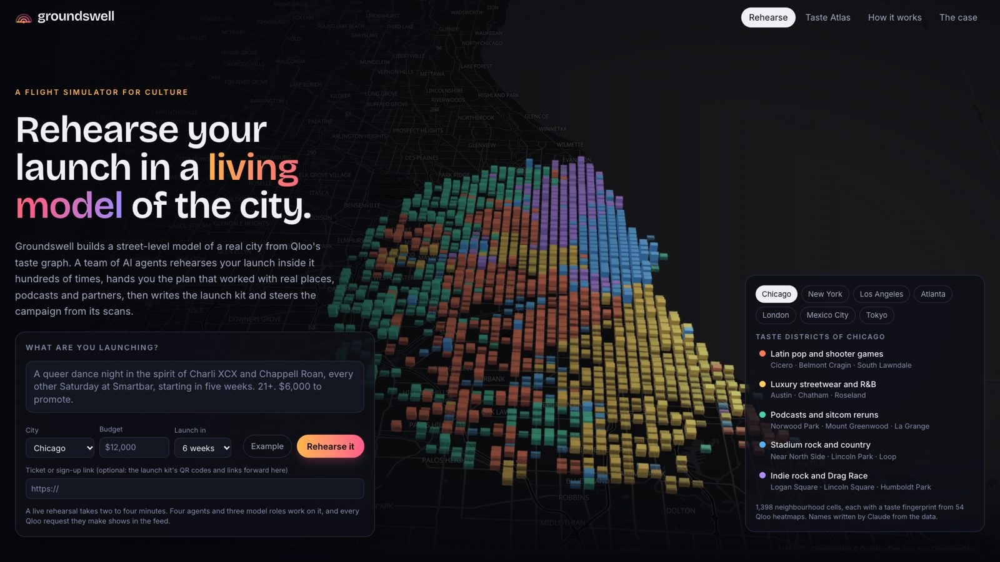</p>

---

## Links

| What | Where |
|---|---|
| The live app (no sign-in) | https://groundswell-city.vercel.app |
| A recorded rehearsal, end to end (Chicago) | https://groundswell-city.vercel.app/rehearse/chicago-headline |
| Its launch kit (open the plan, then "Launch kit") | https://groundswell-city.vercel.app/rehearse/chicago-headline |
| Its mission control (try "Simulate a week", then "Re-plan the budget") | https://groundswell-city.vercel.app/campaign/chicago-headline |
| A launch page in Japanese, as a poster's QR code opens it (Tokyo) | https://groundswell-city.vercel.app/l/tokyo-baseball |
| The Taste Atlas: seven cities mapped by what they love | https://groundswell-city.vercel.app/atlas |
| How it works: method, evidence, calibration, limits | https://groundswell-city.vercel.app/method |
| The business case, with sources | https://groundswell-city.vercel.app/pitch |
| Privacy and data retention | https://groundswell-city.vercel.app/privacy |
| MCP server for other agents | `https://groundswell-city.vercel.app/api/mcp` |
| Every claim mapped to code or data | [docs/CLAIMS.md](docs/CLAIMS.md) |
| Licence | [MIT](LICENSE) |

## For judges: the short version

**A 60-second tour.** Open the [Chicago rehearsal](https://groundswell-city.vercel.app/rehearse/chicago-headline) and watch the team work for 20 seconds (or press "Skip to the plan"). Press **M** to see the whole city, then click a hot zone to fly in to street level. Open the plan's **Launch kit** tab and pick **Bridgeport**: the copy says "Bad Bunny" because Qloo said Bad Bunny is strong *there*. Then open [mission control](https://groundswell-city.vercel.app/campaign/chicago-headline), press **Simulate a week** and **Re-plan the budget**: an agent reads the scans, searches Qloo for new partners and moves the money that's left.

| Criterion | What to look at | Where it lives |
|---|---|---|
| **Qloo, used deeply** | Qloo heatmaps of 54 probe entities become a taste model of 7 cities (10,636 neighbourhood cells, taste districts, cross-city twins). Every launch is mapped, scouted, simulated, written and re-planned from Qloo: heatmaps, places with explainability, podcasts, brands, demographics, audiences, tags, tag search and entity search. Each plan lists every Qloo request behind it. | [`src/lib/qloo/`](src/lib/qloo), [Qloo, end to end](#qloo-end-to-end) |
| **Agentic** | Six Claude agents that choose their own tools: a Director whose tools are its teammates, a Taste Analyst, Scouts, a Strategist that tests variations in a simulator, a Creative Director that checks references on Qloo before writing, and a Field Analyst that re-plans from tracked scans. Rules live in the tools, and they are unit-tested. | [`src/lib/agents/`](src/lib/agents), [`src/lib/kit/`](src/lib/kit), [`src/lib/campaign/`](src/lib/campaign) |
| **Evidence** | From comparables alone, Groundswell finds **44.8%** of the neighbourhoods where a held-out taste is over-represented, against **23.7%** for Claude alone, **22.0%** for "where people are" and **10%** for chance (77 tests, 7 cities, 95% interval 40.0–49.8%), with a control that rules out a measurement artefact. | [Evidence](#evidence), [`data/benchmark/coldstart.json`](data/benchmark/coldstart.json) |
| **A product, end to end** | Brief → live rehearsal → plan → launch kit (copy per neighbourhood, posters with tracked QR codes, emails, scripts, ad brief, calendar, one zip) → launch page → mission control → Field Analyst re-plan. Live runs are saved and shareable. Copy is written in the city's language, with English alongside in Tokyo and Mexico City. | [What it does](#what-it-does) |
| **Honesty** | Every showcase launch is fictional and says so; simulated scans and simulated residents are labelled; the case where Groundswell loses is reported next to the case where it wins; every number maps to a file in [`docs/CLAIMS.md`](docs/CLAIMS.md). | [Limits](#limits) |

## What it does

### 1. Rehearse

Describe a launch in a sentence and pick a city: "Marisol Vega, a Latin R&B singer in the vein of Omar Apollo and Kali Uchis, plays her first headline show at Thalia Hall in Pilsen, six weeks from now. 21+. $12,000." Then watch the team work on a 3D model of the city:

- The **Taste Analyst** chooses comparables Qloo covers well in that city and profiles their fans.
- The **Cartographer** maps where that taste is over-represented, corrected for where Qloo simply has more data, with distance to the venue.
- The **Scouts** pick real partner places in each hot zone, each with a role (poster spot, ticket outlet, pop-up host, street-team base, cross-promotion), plus the podcasts and brands the audience over-indexes on.
- The **Strategist** designs plans and tests variations in the simulator before committing; the **Simulator** rehearses each plan 48 times through a model of word of mouth, against a benchmark that spends the same budget where people are.
- The **Critic** sends changes back, and the team runs a second round. **Street Voices** (simulated residents, labelled as such) react, and the **Producer** writes the week-by-week plan.
- The **Director** runs all of it: it decides the order, retries what fails and decides when a plan is good enough.

<p align="center">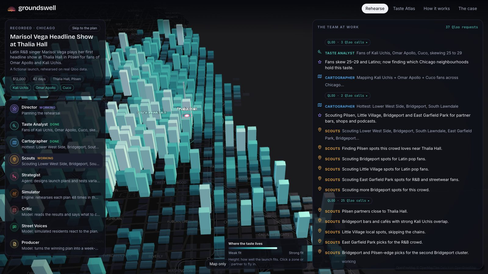</p>

You get the plan with real addresses, its simulated reach with a bad-case band, the benchmark it beat, a what-if panel that re-runs the simulation in your browser, and where the same taste is strongest in the other six cities. On the map, height is people reached and sparks are word of mouth travelling between taste-similar neighbourhoods.

<p align="center">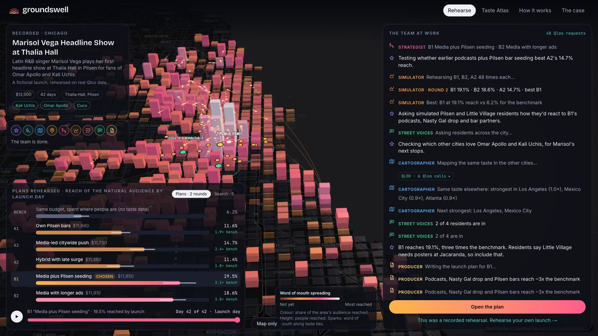</p>

### 2. Launch

The **Creative Director** writes copy for each neighbourhood in the plan: a poster headline, an Instagram caption, a TikTok or Reels hook, an X or Threads post, a podcast host-read and an outreach email to each partner. Before it may use a cultural reference in a neighbourhood's copy, it checks that reference on Qloo for that neighbourhood; its submit tool rejects references that are weak there, claims like "sold out", and assumptions about a partner's premises. Code builds the rest: a poster per partner with its own QR code, a tracked link for every poster, post, email and podcast read, a launch page, an ad-targeting brief per neighbourhood, a calendar file, and one zip with everything.

<table>
  <tr>
    <td width="68%">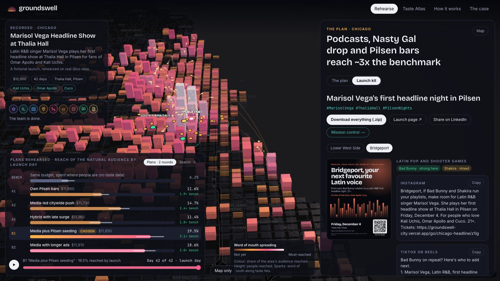</td>
    <td width="32%"></td>
  </tr>
</table>

### 3. Steer

Every tracked link records a scan and forwards to the ticket link. **Mission control** maps scans per neighbourhood against what the rehearsal expected and calls each one ahead, behind or too early, by a stated rule (two standard errors; nothing before 30 scans). The **Field Analyst** reads that, searches Qloo for new partner places where a neighbourhood is behind, and moves the budget not yet spent; its moves are checked against what each action has left. On a showcase campaign, the weeks you simulate and the re-plans you ask for are visible only to you; scanning a poster's QR code with a phone adds a real scan for everyone.

<table>
  <tr>
    <td width="68%">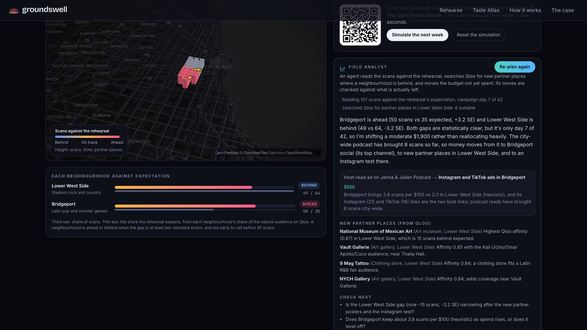</td>
    <td width="32%">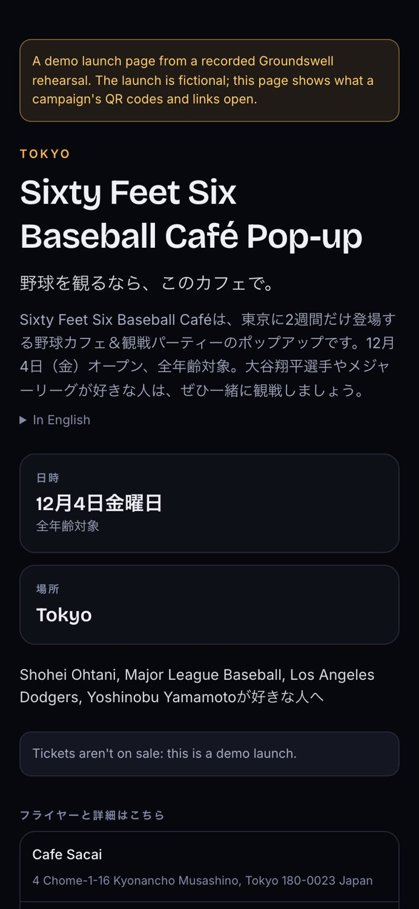</td>
  </tr>
</table>

## What makes it different

- **A city model built from taste, not demographics.** 54 Qloo heatmaps per city give every ~1 km neighbourhood cell a taste fingerprint. Qloo returns a cell only where it has data, so busy downtown cells appear for everything; Groundswell corrects each probe for that density before clustering, which is the difference between "where people are" and "where a taste is over-represented". [`src/lib/atlas/build.ts`](src/lib/atlas/build.ts)
- **A validated core, with a control.** The one thing everything rests on (comparables find a new launch's audience) is benchmarked against Claude alone and against going where people are, with a control that predicts from the correction alone and finds 0.5%. [`src/lib/bench/coldstart.ts`](src/lib/bench/coldstart.ts)
- **A real simulator, not a prompt.** `@groundswell/sim` is a stochastic, spatial Bass diffusion with complex contagion (Centola & Macy), fading buzz and Monte Carlo bands, run on the server for the agents and in the browser for what-if edits. [`packages/sim`](packages/sim)
- **Agents that test against the world.** The Strategist tests variations in the simulator before submitting; the Creative Director tests each cultural reference on Qloo for its neighbourhood before writing; the Field Analyst re-plans against the budget actually left. Their submit tools are pure, tested functions that refuse what can't be backed. [`src/lib/kit/check.ts`](src/lib/kit/check.ts), [`src/lib/campaign/check.ts`](src/lib/campaign/check.ts)
- **Built to finish inside a serverless limit.** A live rehearsal has a time budget (wrap up at 165 s, skip interviews after 215 s), every agent stops the moment it submits, and two live rehearsals run at once on production finished in 123 s and 157 s, inside Vercel's 300 s limit.
- **Copy in the city's language.** Tokyo and Mexico City kits are written in Japanese and Spanish with an English translation alongside; posters subset Noto Sans JP from Google Fonts to just the characters they need. [`src/app/api/poster/route.tsx`](src/app/api/poster/route.tsx)
- **Every number traceable.** The feed lists every Qloo request with its parameters; each plan summarises them by teammate and by kind; [`docs/CLAIMS.md`](docs/CLAIMS.md) maps every public claim to a file and line.
- **Usable by other agents.** An MCP server exposes the atlas, audience mapping, partner scouting and full rehearsals; `rehearse_launch` returns the plan and a link to watch it. [`src/app/api/mcp/route.ts`](src/app/api/mcp/route.ts)
- **Safe to share.** Per-visitor demo state on showcases, rate limits shared across server instances (keyed by a hash of the IP), daily caps, enforced data retention, no cookies or analytics, and pages that pass an axe-core accessibility check with no WCAG A or AA issues.

## Recorded rehearsals

Real runs of the full team, recorded with every event so they replay exactly, each with its launch kit. **The launches are fictional** (the singer, the comedy night, the supporters' group, the café, the film, the start-up and the rapper are invented); the cities, venues, comparables and Qloo data are real.

<!-- SHOWCASES -->
| Launch | City | Plan's reach | Same budget, no taste data | Rounds | Qloo requests |
|---|---|---|---|---|---|
| [A first headline show](https://groundswell-city.vercel.app/rehearse/chicago-headline): Marisol Vega, a new Latin R&B singer, aims to sell out Thalia Hall (about 800 standing). | Chicago | **19.5%** (3.1×) | 6.2% | 2 | 48 |
| [A clean comedy night](https://groundswell-city.vercel.app/rehearse/atlanta-comedy): Clean Slate, a family-friendly stand-up night at the Tabernacle. | Atlanta | **10.3%** (2.4×) | 4.3% | 2 | 53 |
| [A supporters' match night](https://groundswell-city.vercel.app/rehearse/london-football): Big-screen match nights for Chelsea fans, run by an independent supporters' group. | London | **25.8%** (3.2×) | 8.1% | 2 | 56 |
| [A baseball café in Tokyo](https://groundswell-city.vercel.app/rehearse/tokyo-baseball): Sixty Feet Six, a two-week baseball café and viewing-party pop-up. | Tokyo | **19.9%** (3.3×) | 6.0% | 2 | 27 |
| [Indie film previews](https://groundswell-city.vercel.app/rehearse/new-york-film): Tidewater, an independent coming-of-age film, previews at Nitehawk Williamsburg. | New York | **16.4%** (4.0×) | 4.1% | 2 | 44 |
| [A startup's first store](https://groundswell-city.vercel.app/rehearse/mexico-city-startup): Tierra, a sustainable sneaker start-up, opens a pop-up in Roma Norte. | Mexico City | **18.5%** (2.3×) | 7.9% | 2 | 46 |
| [An album release show](https://groundswell-city.vercel.app/rehearse/los-angeles-release): K. Rivers, a West Coast rapper, throws a release show at the Wiltern. | Los Angeles | **18.3%** (4.6×) | 4.0% | 2 | 47 |

Reach is the share of the city's natural audience (people whose taste fits the launch, weighted by distance to the venue) reached by launch day in the simulation.
<!-- /SHOWCASES -->

Across the seven, the final plans reach 2.3–4.6× more of the natural audience than the same budget spent where people are, in simulation. Each run took 149–195 seconds, 24–29 Claude calls and 27–56 Qloo requests.

## Evidence

**Can comparables find a new launch's audience?** A launch has no data of its own, so Groundswell locates its audience from comparables. For 12 established artists, brands and shows that are not atlas probes, in each of 7 cities, we predict where each one's audience is over-represented from three Qloo-similar comparables alone, never looking at its own heatmap. The truth is its own Qloo heatmap; we count how many of its top 10% of cells each method finds.

| Method | Over-representation (index) | Raw volume |
|---|---|---|
| **Groundswell** (comparables, density-corrected index) | **44.8%** (40.0–49.8) | 21.4% |
| The same comparables, raw heatmap | 28.0% | 76.2% |
| Claude alone, naming neighbourhoods with coordinates | 23.7% | 62.5% |
| Where people are (activity, no taste) | 22.0% | 82.5% |
| Control: the density correction alone | 0.5% | 0.0% |
| Chance | 10.0% | 10.0% |

- Groundswell is ahead in every city (36–56%) and beats Claude alone in 65 of 77 tests. 7 tests were skipped where Qloo's heatmap covered under 15% of the city.
- The control finds 0.5%, so the result is not an artefact of measuring truth and prediction the same way; the comparables carry it.
- On raw volume, "where people are" wins: Qloo's raw heatmaps are densest wherever people are, for every taste. That is why the simulator multiplies population (volume) by the index (where the taste is).
- Reproduce: `npm run benchmark`. Results: [`data/benchmark/coldstart.json`](data/benchmark/coldstart.json).

<p align="center">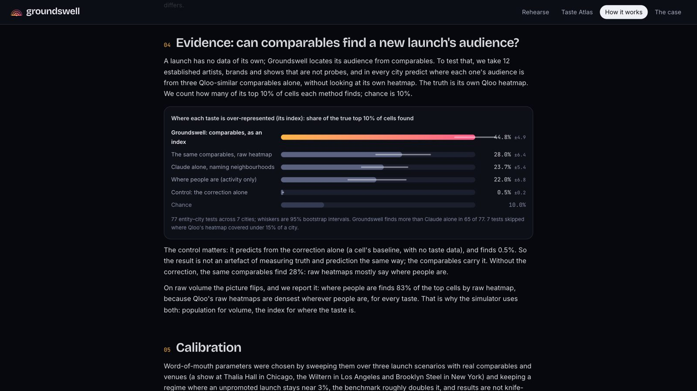</p>

**Calibration.** Word-of-mouth parameters were chosen by sweeping them over three launch scenarios with real comparables and venues (Thalia Hall in Chicago, the Wiltern in Los Angeles, Brooklyn Steel in New York), keeping a regime where an unpromoted launch reaches about 3%, the benchmark roughly doubles it, and results are not knife-edge (`npm run calibrate`, results in [`data/benchmark/calibration.json`](data/benchmark/calibration.json)). Geography changes what works: seeding the hot neighbourhoods reaches about 13% in Chicago and New York but 7% in sprawling Los Angeles.

## Architecture

### The system

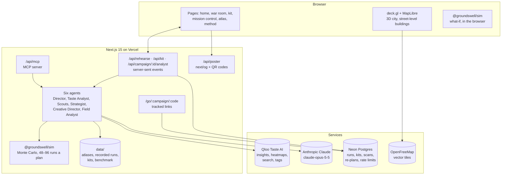

### One rehearsal, step by step

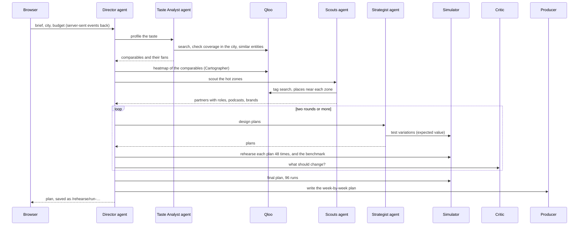

### The data pipeline

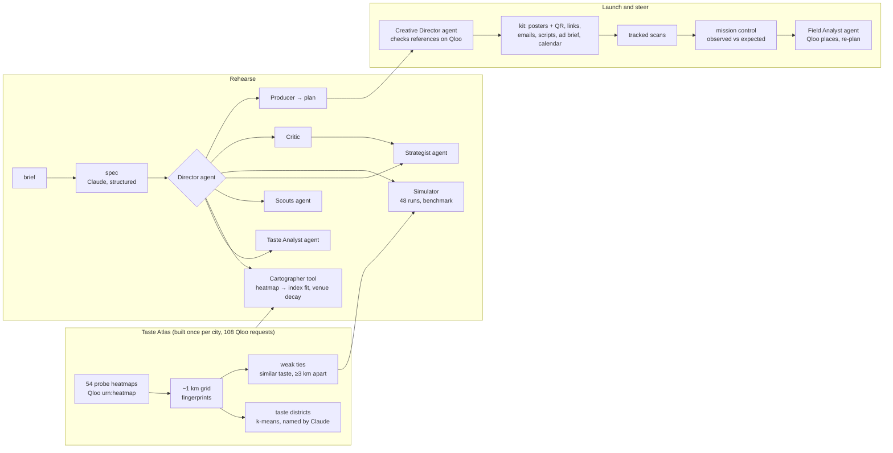

### The city model

For each city, Qloo's heatmap (`filter.type=urn:heatmap`, a point and radius) is pulled for 54 probes: artists, TV shows, brands, games, podcasts and athletes. Cells present for at least eight probes form the grid. Each cell's fingerprint is its within-city percentile for every probe, corrected for how many probes Qloo returns there (busy downtown cells appear for everything), clipped, coverage-weighted and centred. Cells cluster into 5–7 taste districts, named by Claude from the signature only. Each cell is tied to its four most taste-similar cells at least 3 km away: weak ties that carry word of mouth across town. Taste twins compare districts across cities. Building one city takes 108 Qloo requests.

<p align="center">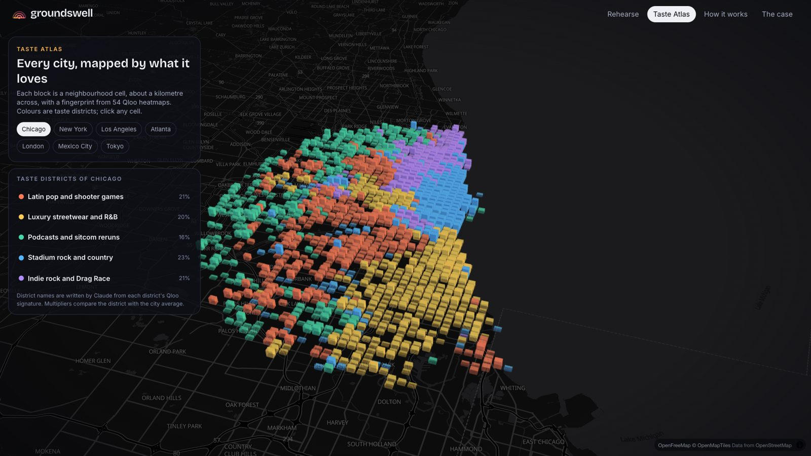</p>

### Where a launch lands

A cell's fit is its percentile for the comparables minus its baseline (what it shows for everything), re-ranked: an index of where the taste is over-represented. Population is a floor plus damped Qloo activity. With a venue, people are weighted by `exp(−distance / 7 km)` (Huff's distance decay). Natural audience = population × 0.25 × fit³ × travel.

### The simulation

[`packages/sim`](packages/sim) is a standalone package: a stochastic, spatial Bass diffusion with complex contagion.

```
h = baseRate + Σ promotion reaching the cell today + wom × exposure^k
```

Exposure is the share of the cell's social neighbourhood (itself, adjacent cells, weak ties) currently talking about the launch; talk fades with a 6-day half-life; k = 1.5 makes clustered buzz spread where thin awareness fizzles (Centola & Macy 2007). Counts are binomial draws; each plan runs 48 times for a mean and a 10th–90th percentile band (96 times for the final plan). Every adopter is credited to an action, word of mouth or organic discovery. Action effects and costs are stated assumptions in one file ([`src/lib/launch/actions.ts`](src/lib/launch/actions.ts)) and on the method page.

### The team

All on Claude (`claude-opus-5-5`) through the Anthropic SDK (tool runner, structured outputs, server-side refusal fallback). "Agent" here means the model chooses which tools to call and when to stop.

| Role | Kind | Tools | Code |
|---|---|---|---|
| Director | Agent | `profile_taste`, `map_audience`, `scout`, `plan`, `simulate`, `critique`, `interview`, `scout_expansion`, `finalize` | [`agents/director.ts`](src/lib/agents/director.ts) |
| Taste Analyst | Agent | `search`, `check_city`, `similar`, `submit` | [`agents/analyst.ts`](src/lib/agents/analyst.ts) |
| Scouts | Agent | `places`, `pick`, `finish` | [`agents/scouts.ts`](src/lib/agents/scouts.ts) |
| Strategist | Agent | `estimate` (tests a variation in the simulator), `submit_plans` | [`agents/strategist.ts`](src/lib/agents/strategist.ts) |
| Creative Director | Agent | `check_reference` (Qloo search + heatmap over a neighbourhood), `submit_kit` | [`kit/director.ts`](src/lib/kit/director.ts) |
| Field Analyst | Agent | `find_places` (Qloo places near a neighbourhood), `submit_replan` | [`campaign/analyst.ts`](src/lib/campaign/analyst.ts) |
| Critic, Street Voices, Producer | Single structured calls | none | [`agents/`](src/lib/agents) |
| Cartographer | Tool (Qloo heatmap → fit map) | | [`launch/fit.ts`](src/lib/launch/fit.ts) |
| Simulator | Engine | | [`packages/sim`](packages/sim) |

Guardrails live in the tools. Plans use only scouted menu items, stay within budget, can't stack more collabs, podcasts or pop-ups than a real team would run, and `finalize` refuses before two rounds of plan → simulate → critique. Partners never include schools, places of worship, clinics, government buildings, gun or cannabis shops, or the launch's own venue; no bars for all-ages or no-alcohol briefs; no children's places unless the launch is all ages. The Creative Director's `submit_kit` rejects unchecked or weak references, copy without its tracked link, claims like "sold out" or "award-winning", and assumptions about a partner's premises. The Field Analyst's `submit_replan` rejects moves larger than an action has left, partners it didn't find on Qloo, and big moves while the data are too thin to call. Agents report reach and cost per point of reach, never head-counts (the simulation's population scale is arbitrary).

### Qloo, end to end

| Qloo request | Used for |
|---|---|
| `/v2/insights` `filter.type=urn:heatmap`, `filter.location` (WKT point + radius) | The atlas (54 probes × 7 cities), each launch's fit, brand-collab reach, the benchmark, the Creative Director's reference checks |
| `/v2/insights` `urn:heatmap` + `output.heatmap.boundary=urn:entity:locality` | Neighbourhood names and boundaries |
| `/v2/insights` `urn:entity:place`, `filter.location`, `feature.explainability` | Partner places in each hot zone and which comparable pulled each in; the Field Analyst's new partners |
| `/v2/insights` `urn:entity:podcast`, `urn:entity:brand` (+ `signal.location.query`) | Podcasts and local brands the audience over-indexes on |
| `/v2/insights` `urn:demographics`, `urn:audience`, `urn:tag` | Who the comparables' fans are: age skew (also the ad brief's age band), audience segments, tags |
| `/search` (+ `filter.location` for venues) | Resolving comparables, venues, probes and the kit's references, with a name check |
| `/v2/tags` (`filter.query`) | The Scouts turn the place categories they want (record stores, cafés) into Qloo tag ids to filter places by |

The Qloo client ([`src/lib/qloo/client.ts`](src/lib/qloo/client.ts)) whitelists parameters (Qloo silently ignores unknown ones), paces requests under the key's rate limit, retries with `Retry-After`, shares identical in-flight requests and caches responses. Every request a run makes is listed in its feed and summarised in its plan.

## Run it locally

Works on macOS, Linux and Windows. You need:

- **Node.js 22.9 or newer** (the scripts use `--env-file-if-exists`). Check with `node --version`. Install from [nodejs.org](https://nodejs.org), or with a version manager: `nvm install 22` (macOS, Linux), `fnm install 22` or [nvm-windows](https://github.com/coreybutler/nvm-windows) (Windows).
- **Git**, and a browser with WebGL (any current Chrome, Edge, Firefox or Safari).
- **Keys**, only for live features: a Qloo hackathon API key and an Anthropic API key. Without them, the recorded rehearsals, their kits and mission control's simulated weeks, the Taste Atlas and the method page all work; live rehearsals, new kits and the Field Analyst need the keys.

**macOS and Linux**

```bash
git clone https://github.com/TusharTechs/groundswell.git
cd groundswell
npm install                 # also copies MapLibre's worker into public/
cp .env.example .env        # then add QLOO_API_KEY and ANTHROPIC_API_KEY
npm run dev                 # http://localhost:3000
```

**Windows (PowerShell)**

```powershell
git clone https://github.com/TusharTechs/groundswell.git
cd groundswell
npm install
Copy-Item .env.example .env   # then add QLOO_API_KEY and ANTHROPIC_API_KEY
npm run dev                   # http://localhost:3000
```

On Windows Command Prompt, use `copy .env.example .env` instead of `Copy-Item`. All scripts are plain Node, so nothing needs a Unix shell.

**A production build** runs the same everywhere: `npm run build` then `npm start`.

**Optional: Postgres.** Set `DATABASE_URL` (for example a free [Neon](https://neon.tech) database) to keep saved runs, kits, scans and rate limits across restarts; tables are created on first use. Without it they live in memory, mirrored to `.data/` in development.

| Variable | Needed for | Default |
|---|---|---|
| `QLOO_API_KEY` | Live rehearsals, kits, the Field Analyst, rebuilding atlases | none |
| `QLOO_BASE_URL` | The Qloo host your key works on | `https://hackathon.api.qloo.com` |
| `ANTHROPIC_API_KEY` | The agents | none |
| `DATABASE_URL` | Durable storage | memory |
| `DAILY_REHEARSALS` | Cap on live rehearsals per day, for everyone | 120 |
| `RATE_LIMIT_SALT` | Salt for hashing IP addresses in rate limits | a fixed default |
| `NEXT_PUBLIC_SITE_URL` | The canonical URL for preview images and QR codes | the Vercel URL |
| `SITE_PUBLIC` | `1` lets search engines index the site | not indexed |

**Troubleshooting.** "Unsupported engine" or `--env-file-if-exists` errors mean Node is older than 22.9. A blank map means WebGL is off in the browser. Port 3000 busy: `npm run dev -- -p 3001`.

**Deploy your own.** Import the repository on [Vercel](https://vercel.com) (it is detected as Next.js through `vercel.json`), add the keys above, and optionally add Neon from the Vercel Marketplace, which sets `DATABASE_URL`.

### Scripts

| Command | What it does | Cost |
|---|---|---|
| `npm run dev`, `npm run build`, `npm start` | Develop, build, serve | none |
| `npm test`, `npm run lint`, `npm run typecheck` | Checks | none |
| `npm run atlas` | Rebuild all city atlases (or `npm run atlas -- chicago`) | 108 Qloo requests and 1 Claude call per city |
| `npm run record` | Record the showcase rehearsals (or `npm run record -- chicago-headline`) | 27–56 Qloo requests and 24–29 Claude calls each |
| `npm run record:kits` | Produce the showcase launch kits | a few Qloo requests and Claude calls each |
| `npm run benchmark` | The cold-start test | about 350 Qloo requests and 85 Claude calls the first time; cached after |
| `npm run calibrate` | Calibration summary (`-- --sweep` for the sweep) | about 45 Qloo requests the first time |
| `npm run launch -- --city chicago "brief…"` | One rehearsal in the terminal | as `record` |
| `npm run mcp:smoke -- http://localhost:3000` | Call the MCP server like an agent would | none |

Scripts cache raw Qloo responses under `.cache/` (git-ignored), so reruns cost no quota.

## Quality

- **83 unit tests** (`npm test`): the simulator, the atlas build, the benchmark metrics, fit, zones, partner filters, action costs, tracked links, the scan report's statistical rule, the budget clock, the scan simulator, the kit's files and inputs, and the guardrails in the Creative Director's and Field Analyst's submit tools.
- **CI** on every push: lint, typecheck, tests and a production build ([`.github/workflows/ci.yml`](.github/workflows/ci.yml)).
- **Accessibility:** axe-core finds no WCAG A or AA issues on the home, atlas, method, case, privacy, war room, kit, mission control and launch pages.
- **Browsers:** checked in Chrome, and in WebKit (Safari's engine, through Playwright) at desktop and iPhone sizes.
- **Production:** an end-to-end run on the live site (live rehearsal, saved link, kit, mission control, Field Analyst) while a second live rehearsal ran at the same time; they finished in 123 s and 157 s (each run's own timing).

## Tech stack

| Layer | Choice |
|---|---|
| App | Next.js 15.5 (App Router), React 19.1, TypeScript, Tailwind CSS 4 |
| Map | deck.gl 9.4 on MapLibre GL 6 with OpenFreeMap tiles; the base map's own 3D buildings at street level |
| Simulation | `@groundswell/sim` (this repo, no dependencies) |
| Agents | Anthropic Claude `claude-opus-5-5`, `@anthropic-ai/sdk` tool runner and structured outputs |
| Taste data | Qloo Taste AI API (hackathon host) |
| Launch kit | `next/og` posters with bundled Bricolage Grotesque and Inter (SIL Open Font License; Noto Sans JP from Google Fonts for Japanese), `qrcode`, `jszip` |
| Storage | Postgres through `@neondatabase/serverless` when `DATABASE_URL` is set; memory otherwise |
| Agents' protocol | Model Context Protocol server, `@modelcontextprotocol/sdk` |
| Hosting | Vercel (functions up to 300 s), Neon Postgres |
| Tests and CI | Vitest, axe-core, GitHub Actions |

## Project structure

```text
groundswell/
├── packages/sim/              # the simulation engine (spatial Bass diffusion, Monte Carlo, optimiser)
├── src/
│   ├── app/                   # pages: home, rehearse/[id], rehearse/live, campaign/[id], l/[id], atlas, method, pitch, privacy; api routes
│   ├── components/            # city map, war room, plan sheet, launch kit, mission control, atlas explorer, home
│   └── lib/
│       ├── qloo/              # Qloo client, parameter whitelist, typed operations
│       ├── atlas/             # cities, probes, atlas build, districts, twins
│       ├── launch/            # spec, taste, fit, scouting, actions, simulation wrapper, venue, expansion
│       ├── agents/            # Director, Taste Analyst, Scouts, Strategist, Critic, Voices, Producer, orchestration
│       ├── kit/               # Creative Director and its checks, tracked links, posters, ad brief, calendar, labels per language
│       ├── campaign/          # scan report, budget clock, scan simulator, per-visitor demo scope, Field Analyst and its checks
│       ├── store.ts           # saved runs, kits, scans, re-plans, rate limits, retention (Postgres or memory)
│       └── bench/             # cold-start benchmark metrics
├── scripts/                   # build-atlas, record-showcases, record-kits, benchmark, calibrate, launch
├── data/                      # built atlases, recorded rehearsals and kits, benchmark results, poster fonts
└── docs/                      # CLAIMS.md, submission drafts, images
```

## HTTP API

| Route | Purpose |
|---|---|
| `POST /api/rehearse` (server-sent events) | A live rehearsal: `{brief, cityId, budget?, days?, launchUrl?}`; saved at the end as `/rehearse/run-…` |
| `POST /api/kit` (server-sent events), `GET /api/kit/:id` | Produce or fetch a campaign's launch kit |
| `GET /api/poster?d=…` | A poster PNG with its QR code |
| `GET /go/:campaign/:code` | A tracked link: records the scan, forwards to the ticket link or launch page |
| `GET /api/campaign/:id`, `POST`/`DELETE /api/campaign/:id/simulate`, `POST /api/campaign/:id/analyst` | Mission control: scans and the latest re-plan, simulated weeks, the Field Analyst (per visitor on showcases, with an `x-demo-session` header) |
| `GET /api/showcase/:id`, `GET /api/atlas/:city`, `GET /api/twins` | Recorded rehearsals, city atlases, taste twins |
| `/api/mcp` | MCP server |

Rate limits per visitor per half hour: 4 live rehearsals, 6 launch kits, 6 Field Analyst runs; across everyone per day: 120 live rehearsals (`DAILY_REHEARSALS`), 300 kits, 400 re-plans. With a database the counts are shared by every server instance.

## Use it from an agent (MCP)

Streamable HTTP at `https://groundswell-city.vercel.app/api/mcp`. In Claude Code: `claude mcp add --transport http groundswell https://groundswell-city.vercel.app/api/mcp`.

Tools: `list_cities`, `taste_twins`, `map_launch_audience`, `scout_launch_partners`, `rehearse_launch` (returns the plan and a link to watch the saved rehearsal and produce its kit), `get_recorded_rehearsal`. Try `npm run mcp:smoke -- https://groundswell-city.vercel.app`.

## Data and privacy

- No personal data is sent to Qloo: only entity names, tags and the locations of cities, neighbourhoods and venues.
- No accounts, cookies, analytics or ads. Briefs go to Anthropic (Claude). A finished live rehearsal is saved (its brief and events) so its link works; a launch kit is saved so its links work.
- Rate limiting keeps a one-way hash of the visitor's IP address and the time of each request for 24 hours, never the address itself. A tracked-link scan stores its link code, time, a coarse country from the hosting platform and whether it was simulated; nothing else about the person.
- Retention, enforced by the app: saved rehearsals, launch kits and scans for 180 days; showcase demo weeks for 24 hours. The full policy is on [`/privacy`](https://groundswell-city.vercel.app/privacy).
- `data/` holds derived results (quantized within-city percentiles, district summaries, recorded runs and kits); raw Qloo responses are never committed.
- Qloo results describe aggregate taste. District names and copy are written with rules against describing people by ethnicity, religion, income, health or politics. Street voices are simulated and labelled.

## Limits

- It is a simulation, not a forecast. Reach is relative to the model's natural audience; it does not predict ticket sales.
- Action effects and costs are stated assumptions, not measured from campaigns.
- Population is approximated from Qloo activity with a floor.
- The benchmark tests where an audience is, not whether a plan sells tickets; that needs real campaign outcomes, which mission control is built to collect.
- Mission control's expectation is the rehearsal's model, not ground truth; its simulated scans are a demonstration, not data. The ad-targeting file is a brief to set up by hand, not an upload format for any ads platform.
- No customers or revenue yet; the business model on [`/pitch`](https://groundswell-city.vercel.app/pitch) is planned, with untested price hypotheses.

## AI disclosure

Built with Claude Code (Claude Opus 5.5), which researched the Qloo API and the hackathon, wrote the code, tests, scripts and documentation, and ran the calibration and benchmark experiments, directed by the author. Inside the product, Claude runs the agents, parses briefs, names districts, writes the launch kit's copy and the simulated street voices; every taste number comes from Qloo.

## License

[MIT](LICENSE) © 2026 Tushar Agarwal. Fonts in `data/fonts` are under the SIL Open Font License (see the licence files beside them).
